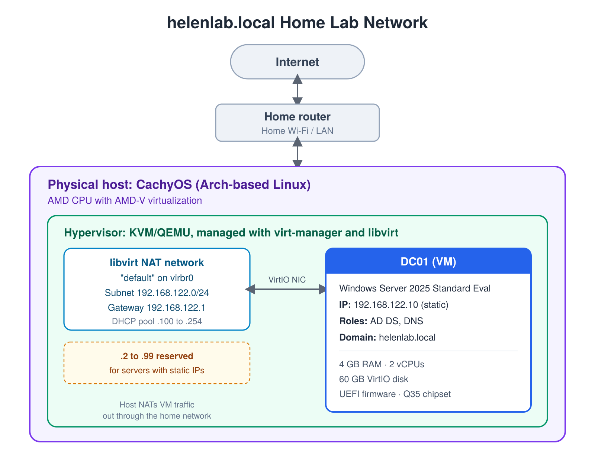
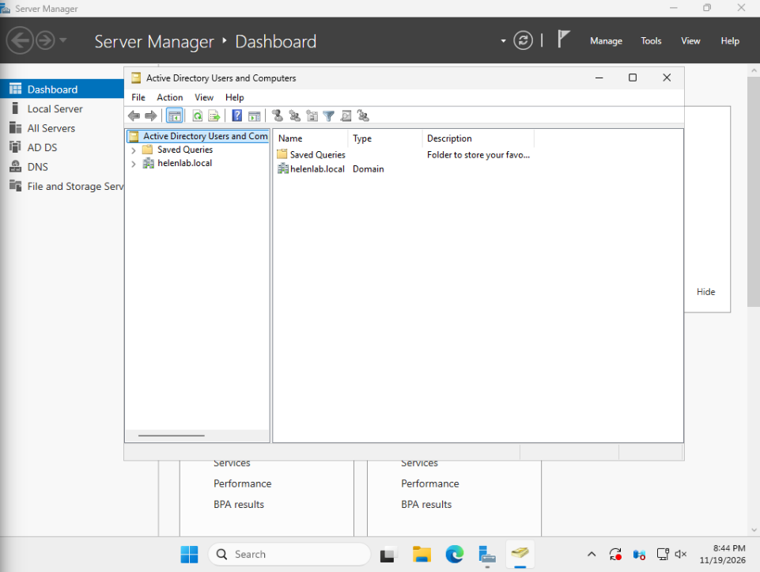

## Why I built this

Wanting to get into IT support I need the necessary skills
with the right tools. Since help desk roles use Active Directory I needed to find
a way to gain that experience. Which led me to building my own domain to practice on.

## Lab setup

- **Host:** CachyOS (Arch-based Linux), AMD CPU with AMD-V
- **Hypervisor:** KVM/QEMU with virt-manager and libvirt
- **Server VM (DC01):** Windows Server 2025 Standard Evaluation,
  4 GB RAM, 2 CPUs, 60 GB VirtIO disk, UEFI
- **Network:** libvirt NAT network (192.168.122.0/24),
  DC01 at static IP 192.168.122.10
- **Domain:** helenlab.local

## Part 1: Preparing the Linux host

- Confirmed hardware virtualization with `lscpu`
- Installed qemu-full, virt-manager, libvirt, swtpm and edk2-ovmf
- Enabled libvirtd, added my user to the libvirt group,
  and started the default network

### Problem: dependency conflicts during install
**Symptom:**  installing libpcap (1.11.0-1.1) breaks dependency 'libpcap=1.10.6' required by lib32-libpcap
**Cause:** A partial upgrade. The main libpcap package had moved
to a newer version, but a 32-bit package that depended on the old
version was no longer available.
**Fix:** Removed the dependent packages, ran a full system upgrade
with `pacman -Syu`, then installed the tools with `--needed`.
**Lesson:** On a rolling-release distro, always fully update
before installing new packages.

## Part 2: Creating the VM

- Created DC01 in virt-manager with Q35 chipset and UEFI firmware
- Switched the disk and network card to VirtIO for performance
- Attached the virtio-win driver ISO as a second CD drive

### Problem: permission prompt on the ISO
**Cause:** VMs run as a separate system user that can't read
files in my private home folder.
**Fix:** Let virt-manager grant search access to the folder.

## Part 3: Installing Windows Server

- Booted from the ISO and chose Desktop Experience

### Problem: no drives showed up in the installer
**Cause:** Windows doesn't include VirtIO storage drivers.
**Fix:** Loaded the driver from `viostor\2k25\amd64` on the
virtio-win CD.

### Problem: no internet after install
**Symptom:** when trying to ping 8.8.8.8 I didn't get a response. In the terminal running `ipconfig` showed my IPv4 starting with 169.254
**Fix:** CashyOS has the ufw firewall turned on by default and it was blocking the VM's network. Running the command
`sudo ufw status` showed me if it was active or not. Since it was active I ran the following to allow the lab network through: 
`sudo ufw allow in on virbr0` 
`sudo ufw route allow in on virbr0` 
`sudo ufw route allow out on virbr0` 
`sudo ufw reload` 
Then in the VM I ran
`ipconfig /release` 
`ipconfig /renew` 

- Installed virtio-win guest tools and took a "Clean install" snapshot

## Part 4: Promoting DC01 to a domain controller

- Reserved .2 to .99 for static IPs by editing the libvirt DHCP range
### Problem: the network config wouldn't save
**Symptom:** `virsh net-edit` failed with
"Cannot parse socket address '192.168.122.10O'".
**Cause:** A typo. I'd typed a capital letter O instead of a zero,
and left off the last digit.
**Fix:** Reopened the file with `sudo EDITOR=nano virsh net-edit default`,
corrected the range start to `192.168.122.100`, then restarted the
network with `virsh net-destroy` and `virsh net-start`.
**Lesson:** Read the error message closely. It printed the exact
value it couldn't understand, which pointed straight at the typo.
- Renamed the server to DC01 and set a static IP
- Installed AD DS and DNS with PowerShell:
  `Install-WindowsFeature AD-Domain-Services, DNS -IncludeManagementTools`
- Promoted DC01 to a new forest, helenlab.local
- Verified the domain in Active Directory Users and Computers

## What I learned

- **Read the error message closely.** Twice the answer was in the
  error itself. The pacman conflict named the exact package causing
  the problem, and the virsh error printed the typo I'd made
  ("10O" instead of "100").
- **On a rolling-release distro, update before you install.** Most of
  my early problems came from installing new packages on a system
  that wasn't fully updated. Running `pacman -Syu` first is now
  a habit.
- **Virtual hardware needs drivers too.** Windows couldn't see the
  disk until I loaded the VirtIO storage driver during setup. It
  showed me how much an OS depends on drivers before it can do
  anything.
- **Active Directory depends on DNS.** Installing AD DS also set up
  DNS, because clients find the domain controller through DNS.
  If DNS is wrong, logins and domain joins fail, so it's one of
  the first things I'll check when troubleshooting.

  
## What's next

Creating OUs, users and groups, joining a Windows 11 client to
the domain, and working through simulated help desk tickets.
