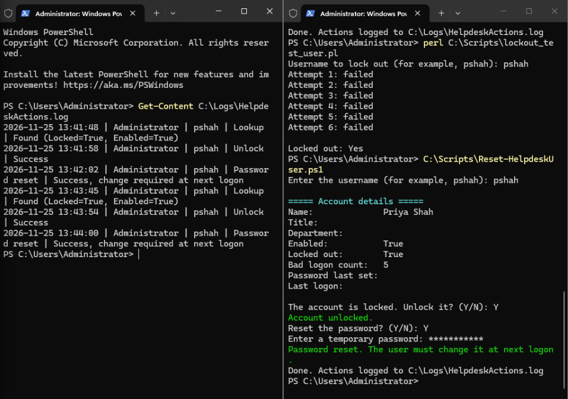

In my [last post]({{ site.baseurl }}), I filled my `helenlab.local` domain with a fictional company. This time I automated the most common help desk ticket there is: **"I can't log in."**

I built the same tool twice, once in PowerShell and once in Perl. Then I added logging so every action leaves an audit trail, and I wrote a second Perl script to lock out a test account on purpose so I'd have tickets to practise on.

## What the tool does

A technician runs the script, types a username, and the tool walks them through the ticket:

1. **Looks up the user** once and saves the details.
2. **Shows what a tech needs** to diagnose the problem.
3. **Stops if the account is disabled**, because re-enabling a former employee needs approval from a manager or HR.
4. **Offers to unlock** the account if it's locked.
5. **Offers to reset the password**, hiding it as it's typed, and forces the user to choose their own at next sign-in.
6. **Logs every step** to a file.

## Why it fetches these details

The point isn't to reset passwords by reflex. It's to find the real cause first.

| Property | Question it answers |
|---|---|
| Title, Department | Is this the right person, and who approves changes? |
| Enabled | Is the account turned on, or has the person left? |
| LockedOut | Is unlocking all that's needed? |
| BadLogonCount | How many wrong passwords, and is something still trying? |
| PasswordLastSet | Did they just change it and forget it? |
| LastLogonDate | Is the account actively used? |

Together they point to a fix. Locked out with a password set yesterday usually means they forgot the new one. An account that relocks minutes after unlocking, with BadLogonCount climbing, usually means an old password is saved on their phone or a mapped drive.

## The PowerShell version

The lookup is one line. By default `Get-ADUser` returns only about ten basic properties, so the rest have to be asked for by name:

```powershell
$user = Get-ADUser -Identity $username -Properties Title, Department, Enabled, LockedOut, PasswordLastSet, LastLogonDate, BadLogonCount
```

Everything after that reads from `$user`, so Active Directory is only queried once. Displaying a property inside text needs the `$( )` subexpression:

```powershell
Write-Host "Locked out:        $($user.LockedOut)"
```

The actual fixes use dedicated cmdlets:

```powershell
Unlock-ADAccount -Identity $username
Set-ADAccountPassword -Identity $username -Reset -NewPassword $newPassword
Set-ADUser -Identity $username -ChangePasswordAtLogon $true
```

The new password comes from `Read-Host -AsSecureString`, so it's never shown on screen or stored in the script.

## The Perl version

Perl doesn't have the ActiveDirectory module, so this version talks to Windows through **ADSI** using the `Win32::OLE` module from Strawberry Perl:

```perl
my $user = Win32::OLE->GetObject("WinNT://HELENLAB/$username,user");

if ($user->{IsAccountLocked}) {
    $user->{IsAccountLocked} = 0;
    $user->SetInfo();          # nothing is saved until SetInfo runs
}
```

A few things work differently from PowerShell:

| Task | PowerShell | Perl (ADSI) |
|---|---|---|
| Read a property | `$user.LockedOut` | `$user->{IsAccountLocked}` |
| Save a change | Automatic | `$user->SetInfo()` |
| Force a password change | `-ChangePasswordAtLogon $true` | `$user->{PasswordExpired} = 1` |
| Hide password input | `Read-Host -AsSecureString` | `ReadMode('noecho')` from Term::ReadKey |
| Case sensitive? | No | Yes |

Building it twice was the best way to understand what each line was actually doing, rather than just copying it.

## Creating test tickets: a lockout script

To test the unlock step, I needed a locked account. I wrote a short Perl script that signs in as a test user with the wrong password six times:

```perl
my $ldap = Win32::OLE->GetObject('LDAP:');
for my $try (1 .. 6) {
    my $conn = $ldap->OpenDSObject("LDAP://helenlab.local", "HELENLAB\\$username", 'WrongPass1!', 1);
    print "Attempt $try: ", ($conn ? "signed in" : "failed"), "\n";
}
```

This is for lab test accounts only. Locking out real accounts on purpose would cause real outages.

### Problem: the account never locked

**Symptom:** The script reported six failed attempts, but the account stayed unlocked.

**Cause:** Windows never locks accounts by default. The account lockout threshold is 0, which means "never lock."

**Fix:** In Group Policy Management, I edited the **Default Domain Policy** under Computer Configuration, Policies, Windows Settings, Security Settings, Account Policies, **Account Lockout Policy**, set the threshold to 5, and ran `gpupdate /force`.

**Lesson:** A security control can look like it isn't working when it was never turned on. Check the policy before blaming the script.

## Adding an audit trail

Real IT teams need to answer "who reset this account, and when?", so I added a logging function to both versions. Each action becomes one line:

```powershell
function Write-Log {
    param([string]$Target, [string]$Action, [string]$Result)
    $time = Get-Date -Format "yyyy-MM-dd HH:mm:ss"
    Add-Content -Path $logFile -Value "$time | $env:USERNAME | $Target | $Action | $Result"
}
```

`Add-Content` appends, so old entries are never overwritten, and `$env:USERNAME` records which technician ran the script. The Perl version does the same with `open` in append mode (`>>`) and `strftime` for the timestamp.

A sample of the log:



The one rule I followed throughout: **the password is never logged**. Logs are read by many people, so a password in a log is a password exposed.

### Problem: changes made outside the script weren't logged

**Symptom:** When I unlocked a user in Active Directory Users and Computers instead of the script, nothing appeared in my log.

**Cause:** My log only records what the script does. Any other tool bypasses it.

**Fix:** Windows keeps its own record in the domain controller's **Security event log**, as long as auditing is enabled:

```powershell
auditpol /get /subcategory:"User Account Management"
Get-WinEvent -FilterHashtable @{LogName='Security'; Id=4767,4724,4740} -MaxEvents 10
```

| Event ID | Meaning |
|---|---|
| 4625 | Failed sign-in |
| 4740 | Account locked out |
| 4767 | Account unlocked |
| 4724 | Admin reset a password |
| 4723 | User changed their own password |

**Lesson:** A tool's log adds context, like why a step was skipped or escalated. The Security log is the trustworthy record, because it captures every tool and clearing it creates its own event.

## What I learned

- **Diagnose before you fix.** The account details usually point straight to the cause.
- **Read-only properties tell the story.** BadLogonCount, PasswordLastSet and LastLogonDate are recorded by Windows and can't be edited, which is what makes them useful evidence.
- **Writing the same tool in two languages** forced me to understand each step instead of copying it.
- **Logging is part of the job.** Who, what, when, and never the password.

## What's next

Next I'll build a script that reads those Security events and turns them into a simple weekly report of lockouts, unlocks and resets. Then it's on to shared folders and Group Policy.
